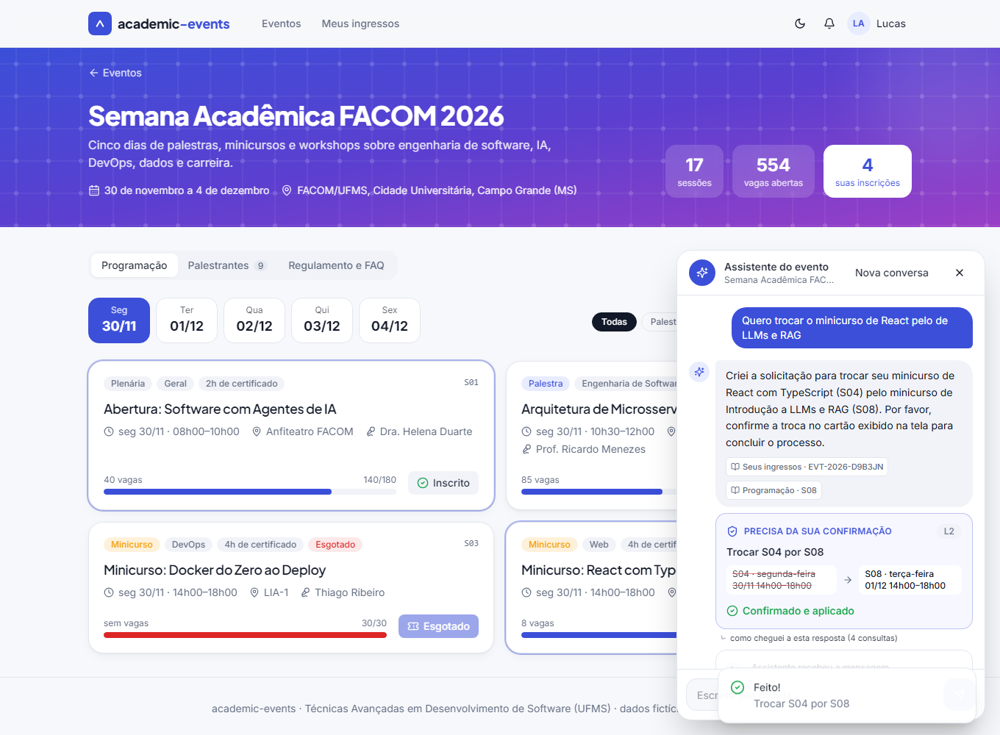
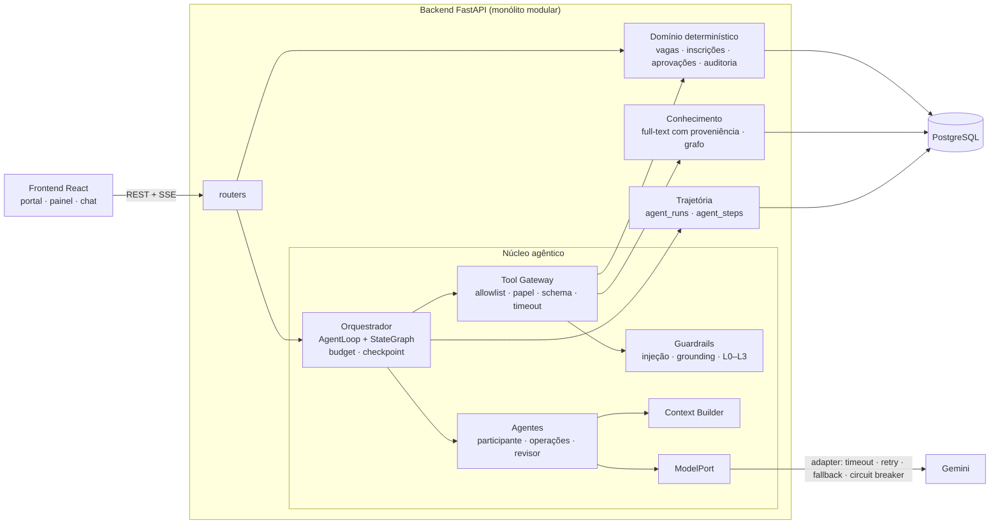
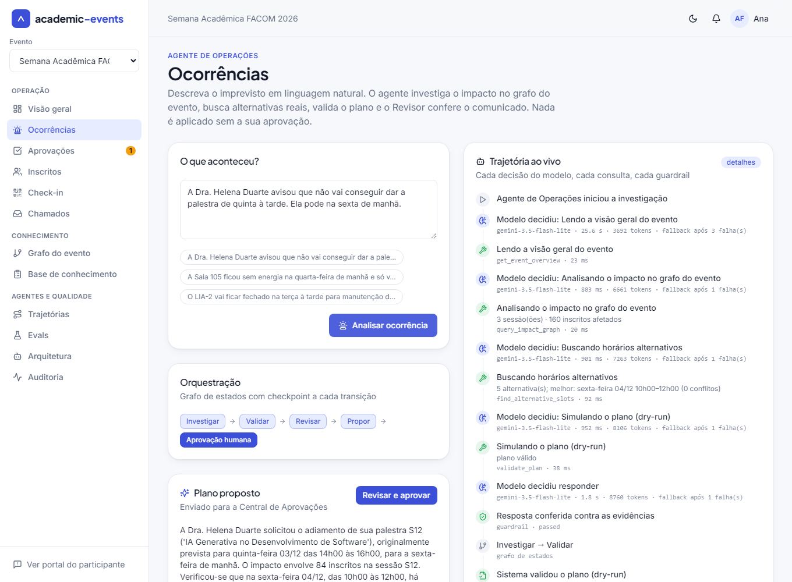

# academic-events

Plataforma de eventos acadêmicos (semanas acadêmicas, simpósios, hackathons) com **agentes de IA** que atendem participantes e ajudam a comissão organizadora a resolver imprevistos, sempre com **evidência**, **limites de autonomia** e **aprovação humana**.

> Trabalho de **Técnicas Avançadas em Desenvolvimento de Software** (TADS · UFMS · 2026-2), Prof. Vitor Mesaque Alves de Lima.
> **Autor:** [Igor Lazarin Oliani](https://github.com/Igor-Lazarin-Oliani) · Todos os dados são fictícios.



## Início rápido

Requer apenas Docker. Sem chave do Gemini, tudo funciona, exceto os agentes, que entram em **modo degradado**.

```sh
cp .env.example .env          # coloque sua GEMINI_API_KEY (https://aistudio.google.com/apikey)
docker compose up -d --build  # db + backend + frontend; o seed roda sozinho
```

| O quê | Onde |
|---|---|
| **Aplicação** | http://localhost:8080 |
| API (Swagger) | http://localhost:8000/docs |
| Contas de demonstração (senha `senha123`) | `participante@exemplo.com` (Lucas) · `maria@exemplo.com` · `ana.org@exemplo.com` (comissão) · `carla.staff@exemplo.com` (credenciamento) · `bruno.org@exemplo.com` (comissão de outro evento) · `admin@exemplo.com`. A tela de login tem botões para cada uma |

```sh
docker compose exec backend pytest              # 58 testes (domínio, núcleo agêntico, agentes com FakeModel, API/SSE)
docker compose exec backend python /evals/run.py # 22 evals de comportamento contra o modelo real
docker compose down -v && docker compose up -d   # reset do banco de demonstração
```

## O problema

Comissões organizadoras de eventos acadêmicos são **pequenas, voluntárias e rotativas**. Elas passam a semana do evento:

1. respondendo as **mesmas dúvidas** no WhatsApp ("tem certificado?", "posso trocar de minicurso?", "mudou de sala?");
2. apagando **incêndios de última hora** (palestrante cancelou, sala sem energia) sem saber direito **quem é afetado**;
3. mandando **comunicados com erro** (horário ou sala trocados), o que gera mais dúvidas.

Um formulário não resolve: as perguntas chegam em linguagem livre, a resposta depende do regulamento **e** dos dados de cada pessoa, e um imprevisto exige **investigar** (o próximo passo depende do que foi descoberto). Já as regras de vagas, inscrição e check-in são estáveis e **continuam em código determinístico**: arquitetura híbrida, não "agente em tudo".

| Situação | Abordagem | Por quê |
|---|---|---|
| Reserva de vaga, troca, check-in, execução de planos | **Código** | Regra conhecida, crítica, precisa ser atômica |
| Dúvida livre do participante | **Agente + tools** | Entrada ambígua, múltiplas fontes, pode virar ação |
| Ocorrência da comissão | **Loop agêntico em grafo de estados** | O próximo passo depende do que foi investigado |
| Comunicado aos inscritos | **Evaluator-optimizer** | Texto gerado precisa ser conferido contra os fatos |
| Aprovar e executar | **Humano + código** | Efeito coletivo e externo (L3) |

## Os agentes

| Agente | Objetivo | Decide | Pode | Não pode | Para quando |
|---|---|---|---|---|---|
| **Assistente do Participante** | resolver dúvidas e pedidos sobre o evento e os **próprios** ingressos | quais fontes consultar; responder, abster-se, recusar, propor ação ou escalar | 7 tools: buscar regulamento, programação, os próprios ingressos (L0), abrir chamado (L1), **propor** cancelamento/troca (L2) | ver dados de outros, alterar a programação, executar ações | `final_answer` aprovada pelo grounding, budget, modelo fora |
| **Agente de Operações** | transformar uma ocorrência em um **plano de ação verificável** | elemento afetado, alternativa, passos, comunicado | 6 tools L0: visão geral, **grafo de impacto**, horários alternativos, salas livres, regulamento, dry-run | executar, notificar, ver nomes/e-mails | plano proposto (pausa para humano), `need_info`, revisões esgotadas, budget |
| **Revisor** | garantir que o comunicado é fiel, completo e claro | aprovar ou devolver com problemas objetivos | checagens determinísticas + LLM com schema | — | um parecer |

Fichas completas em [docs/agentes.md](docs/agentes.md); contratos das tools em [docs/contratos-tools.md](docs/contratos-tools.md) (gerado do código).

## Arquitetura



Diagramas de sequência, do grafo de estados e da governança em [docs/arquitetura.md](docs/arquitetura.md).

**Ports & Adapters:** os agentes dependem do `ModelPort`, não do Gemini. O `GeminiAdapter` (REST) e o `FakeModel` (testes, sem custo) implementam o mesmo contrato. O orquestrador é próprio (~250 linhas), porque frameworks são implementação, não arquitetura (D4).

### Fluxo principal da demonstração

1. A organizadora escreve: *"A Dra. Helena Duarte avisou que não vai conseguir dar a palestra de quinta à tarde. Ela pode na sexta de manhã."*
2. O **Agente de Operações** consulta o grafo (S12, 84 inscritos), busca horários em que palestrante e sala estão livres, escolhe sexta 10h00 (**0 conflitos** para os inscritos), simula o plano e redige o comunicado.
3. O **Revisor** confere datas, horários e salas contra o dry-run. Se houver erro, devolve, e o agente corrige (até 2 vezes).
4. O plano chega à **Central de Aprovações** com antes/depois, 84 destinatários, o comunicado e o parecer.
5. A organizadora aprova. O sistema executa **tudo ou nada**, notifica os 84 inscritos e a run fecha como `DONE`, com a aprovação registrada na trajetória.



## Critérios de avaliação atendidos

| Critério (peso) | Como é atendido | Onde ver |
|---|---|---|
| **Problema e justificativa agêntica (15%)** | Dor real de comissões voluntárias; agentes só onde há linguagem natural, ambiguidade ou investigação; o resto é código | seção [O problema](#o-problema), [docs/planejamento.md](docs/planejamento.md) |
| **Arquitetura e responsabilidades (25%)** | 3 agentes coesos; roteamento determinístico por papel; **grafo de estados** explícito com checkpoint; **evaluator-optimizer**; **human-in-the-loop**; ports & adapters | [docs/arquitetura.md](docs/arquitetura.md), [docs/agentes.md](docs/agentes.md), tela **Arquitetura** |
| **Contexto, tools e segurança (15%)** | 13 tools tipadas com nível L0–L3; **Tool Gateway** ("o LLM solicita, o sistema autoriza e registra"); contrato de contexto JSON; RAG lexical com **proveniência e versão**; **grafo de impacto**; escopo no SQL; guardrail de injeção; LGPD | [docs/contratos-tools.md](docs/contratos-tools.md), telas **Base de conhecimento** e **Grafo** |
| **Qualidade da solução (20%)** | Regras do projeto anterior (reserva atômica, idempotência) + troca atômica, conflito, limite; dry-run e execução tudo ou nada; timeout, retry, **fallback de modelos**, **circuit breaker**, budget, tool terminal; **modo degradado**; frontend de produto | [docs/decisoes.md](docs/decisoes.md) (D1–D19) |
| **Testes, evals e observabilidade (15%)** | 58 testes pytest (incl. concorrência real e agentes com `FakeModel`); **22 evals** com o modelo real em 10 categorias (abstenção, acesso negado, injeção, tool fora, oráculo SQL); E2E Playwright; trajetória de cada execução + métricas | [docs/evals.md](docs/evals.md), telas **Trajetórias** e **Evals** |
| **Demonstração e documentação (10%)** | este README, diagramas, 19 decisões registradas, roteiro de demo | [docs/roteiro-demo.md](docs/roteiro-demo.md) |

### Checklist do laboratório "Contexto Governado"

| Item | Atendimento |
|---|---|
| Intenção clara | atendimento ao participante e resolução de ocorrências |
| Tools reais (incl. consulta) | 13 tools; 10 de consulta (L0) |
| Fonte de conhecimento | regulamento, FAQ e mural versionados, com `source_id`/seção/versão/confiabilidade |
| Regra de escopo/permissão | participante só vê os próprios ingressos; organizador só o próprio evento (403 testado e avaliado) |
| Evidência na resposta | `evidence[]` obrigatório em `kind=answer`, verificado pelo guardrail de grounding |
| Aprovação humana | propostas L2 (o próprio participante) e L3 (organizador), por rotas que **não são tools** |
| Saber dizer "não sei"/"não posso" | evals de abstenção, acesso negado e ferramenta indisponível |

## Testes e evals

| Camada | Quantidade | Resultado |
|---|---|---|
| Unitários e de contrato (domínio, conhecimento, aprovações, resiliência) | 32 | ✅ |
| Núcleo agêntico com `FakeModel` (gateway, loop, guardrails, grafo de estados) | 17 | ✅ |
| Agentes ponta a ponta com `FakeModel` + API/SSE | 9 | ✅ |
| **Evals com o modelo real** | 22 casos / 10 categorias | **21/22** na execução final ([histórico de 6 execuções, falhas e correções](docs/evals.md)) |
| E2E pela UI (Playwright, modelo real) | 2 fluxos + 17 telas | ✅ |

## Estrutura

```
academic-events/
├── README.md · docker-compose.yml · .env.example
├── docs/            planejamento · prompt (contexto) · arquitetura · agentes · contratos-tools · decisoes · evals · roteiro-demo · img/ · referencias/
├── backend/
│   ├── app/
│   │   ├── core/          config · banco · JWT · erros · correlation-id
│   │   ├── modules/       DOMÍNIO DETERMINÍSTICO: auth · events · tickets · approvals · notifications · activity
│   │   ├── knowledge/     ingestão · busca full-text · grafo de impacto
│   │   ├── agentic/       NÚCLEO AGÊNTICO: ports · adapters · orchestrator · tools · guardrails · context · agents · prompts · api · tracing
│   │   └── seed/          Semana Acadêmica FACOM 2026 + Hackathon (fictícios)
│   └── tests/             pytest (PostgreSQL real)
├── evals/           cases/*.yaml · run.py · reports/
├── frontend/        React + Vite + TS + Tailwind · nginx
├── e2e/             Playwright (telas e fluxos)
└── scripts/         gen_tool_contracts.py
```

## Limitações e próximos passos

- **Provedor instável no free tier:** o `gemini-3.5-flash` respondeu 503 ou passou do timeout com frequência; a cadeia de fallback cobre, mas a latência pode chegar a dezenas de segundos na primeira chamada. Para a demo, use `GEMINI_MODEL=gemini-3.5-flash-lite`.
- **Busca só lexical:** o próximo passo é adicionar busca vetorial (pgvector) com fusão RRF; o contrato da tool não muda.
- **Memória de curto prazo apenas** (últimas 6 mensagens); preferências duráveis do participante ficaram fora do escopo.
- **Retomada de runs após reinício do servidor:** o checkpoint é gravado, e a retomada pós-aprovação funciona; retomar uma run interrompida no meio da investigação não foi implementado.
- **Sem migrações** (D12) e token JWT em `localStorage` (D18): adequados ao trabalho, não à produção.
- **Notificações só na plataforma** (sem e-mail/SMS).
- **Aderência do modelo leve (eval P08, instável):** quando o participante pede para mudar a programação, o Flash-Lite às vezes oferece outra palestra como substituta, apesar da instrução. É seguro (nenhuma proposta, nenhum efeito), mas indesejado. Próximo passo: classificador determinístico de intenção antes do loop, ou o modelo principal no Assistente.
- Os evals rodam sob demanda (custo e cota); não há execução em CI.
