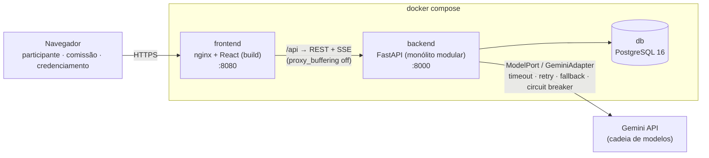
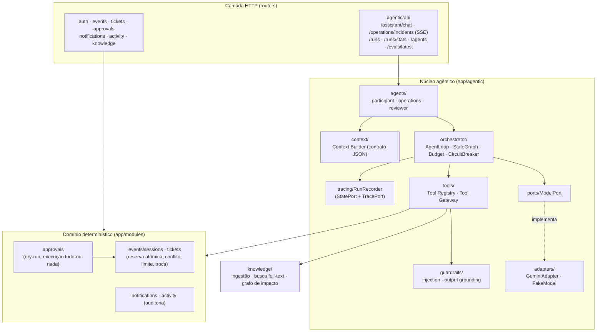
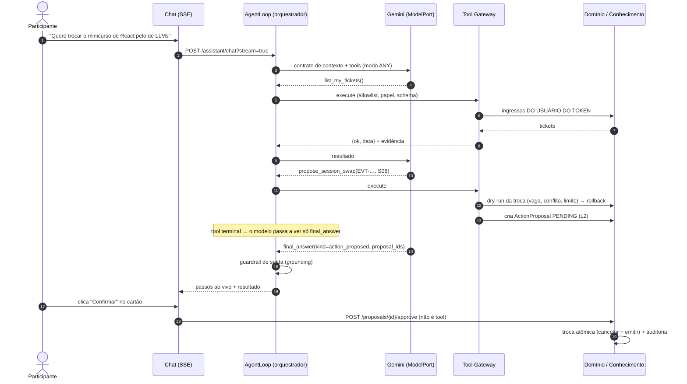
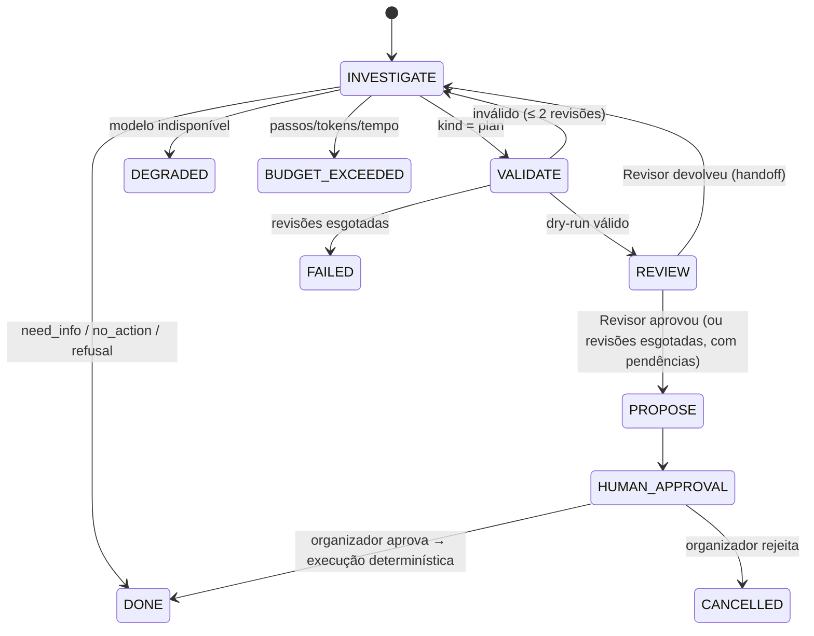

# Arquitetura

Visão detalhada da arquitetura do `academic-events`. O resumo e o mapa dos requisitos estão no [README](../README.md); as justificativas, em [decisoes.md](decisoes.md).

## 1. Visão de contêineres

Três contêineres. Não há microsserviços (D1): as fronteiras são módulos e contratos.

## 2. Módulos do backend (ports & adapters)

| Port | Contrato | Adapters |
|---|---|---|
| `ModelPort` | `generate(system, messages, tools, force_tool, response_schema, tier)` → `ModelResponse` (texto, tool_calls, uso, tentativas) | `GeminiAdapter` (REST), `FakeModel` (testes) |
| `ToolGateway` | `execute(name, args, ctx, allowed)` → `{ok, data \| error}` | tools Python locais (`participant_tools`, `ops_tools`) |
| `RunRecorder` | `step()`, `checkpoint()`, `pause()`, `finish()` | PostgreSQL (`agent_runs`, `agent_steps`) com sessão própria e commit por passo |

Trocar o provedor de LLM é só escrever um novo adapter: nenhum agente, tool ou regra de domínio muda.

## 3. Assistente do Participante: loop agêntico

## 4. Agente de Operações: grafo de estados

- **INVESTIGATE:** loop agêntico com tools L0 (visão geral, grafo de impacto, horários alternativos, salas livres, regulamento, `validate_plan`). O guardrail exige `query_impact_graph` antes de qualquer plano.
- **VALIDATE:** o **sistema** acrescenta `NOTIFY_PARTICIPANTS` para as sessões tocadas (D16) e aplica o plano num SAVEPOINT desfeito em seguida (D9).
- **REVIEW:** Revisor híbrido (D17), com checagens determinísticas sobre os fatos do dry-run e LLM com saída JSON por schema.
- **PROPOSE:** cria a `ActionProposal` L3 com impacto calculado pelo backend (destinatários reais).
- **HUMAN_APPROVAL:** a run fica `WAITING_APPROVAL`, com checkpoint em `agent_runs.state`. A decisão humana (`/proposals/{id}/approve`) executa os passos tudo ou nada e fecha a run (`DONE`/`CANCELLED`), registrando o passo `approval` na trajetória.

## 5. Contexto, estado, memória e conhecimento

| Conceito | Implementação | Onde |
|---|---|---|
| Prompt | instruções versionadas por agente | `backend/app/agentic/prompts/*.md` |
| Contexto | contrato JSON por execução: escopo, dias do evento, fontes disponíveis, políticas e budget | `agentic/context/builder.py`, visível na tela de trajetória |
| Estado | run, passos, nó atual e checkpoint do grafo | `agent_runs`, `agent_steps` |
| Memória | curto prazo: últimas 6 mensagens da conversa | `conversations`, `conversation_messages` |
| Conhecimento | regulamento, FAQ e avisos versionados (`ACTIVE`/`SUPERSEDED`, `OFFICIAL`/`UNVERIFIED`), recuperados sob demanda | `knowledge_documents`, `knowledge_chunks` (full-text pt) |
| Grafo | projeção evento → sessão → sala/palestrante, com inscritos agregados | `knowledge/graph.py` |

## 6. Governança: onde cada controle mora

| Controle | Mecanismo | Não depende do prompt? |
|---|---|---|
| Participante só vê os próprios ingressos | tools sem `user_id`; `get_own_ticket` → 403 | ✅ |
| Organizador só opera o próprio evento | `ensure_can_manage_event` no roteamento e nas tools | ✅ |
| Agente não executa efeitos | tools L2/L3 só criam propostas; aprovação é rota humana | ✅ |
| Documento envenenado | redação das frases suspeitas + `trust=UNVERIFIED` | ✅ (o prompt reforça) |
| Resposta sem fonte | guardrail de grounding na `final_answer` | ✅ |
| Loop infinito / custo | budget (passos, tokens, tempo), tool terminal, chamada duplicada | ✅ |
| LGPD | o LLM vê contagens; e-mails mascarados no trace; seed fictício | ✅ |
| Escopo do conhecimento | filtro `event_id` + `ACTIVE` no SQL | ✅ |

## 7. Observabilidade

- **Trajetória por execução** (`agent_steps`): `run.start` (com o contrato de contexto), `model.call` (modelo efetivo, tentativas/fallback, tokens, latência), `tool.call`/`tool.result` (status, duração), `guardrail`, `transition`, `validation`, `review`, `handoff`, `proposal`, `approval`, `run.end`.
- **Ao vivo:** SSE no chat e na tela de ocorrências.
- **Métricas:** `GET /runs/stats` (execuções por agente e status, latência p50/p95, tokens, taxa de erro de tools, guardrails acionados), no painel.
- **Auditoria de domínio:** `activity_logs` na mesma transação da mudança, com `source` (`api`/`agent`/`system`), ator e `correlation_id`.
- **Correlação:** `X-Correlation-Id` liga a requisição HTTP, a run e a auditoria.
